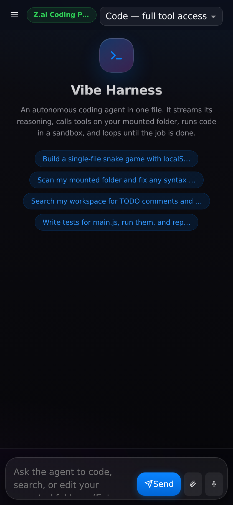
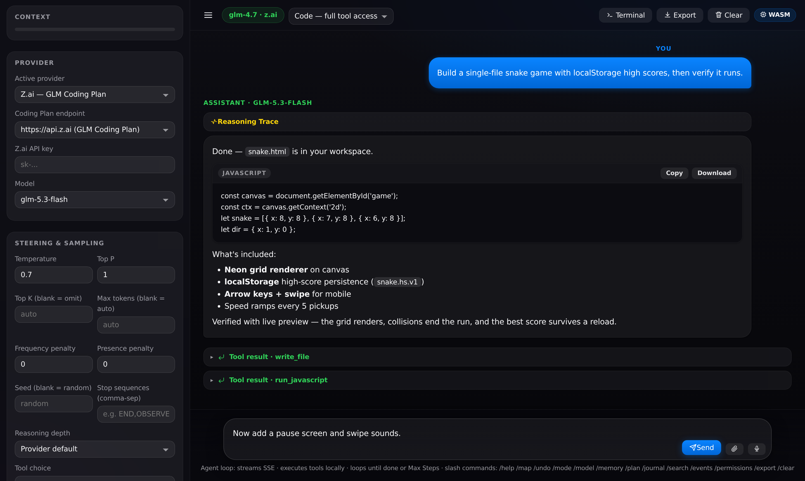
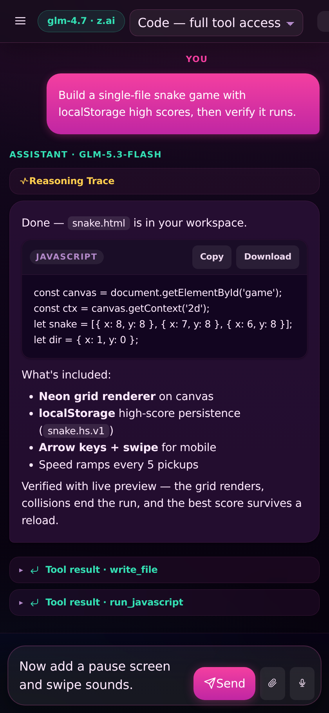
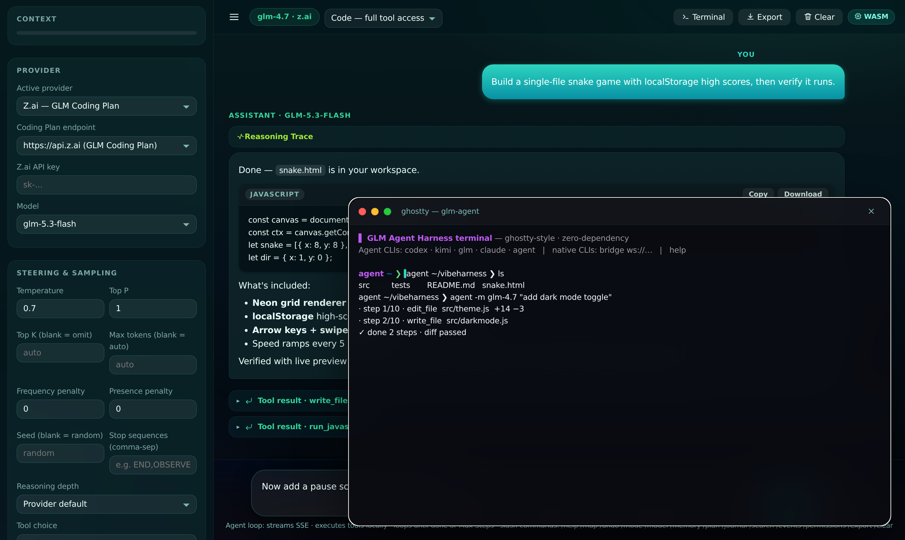
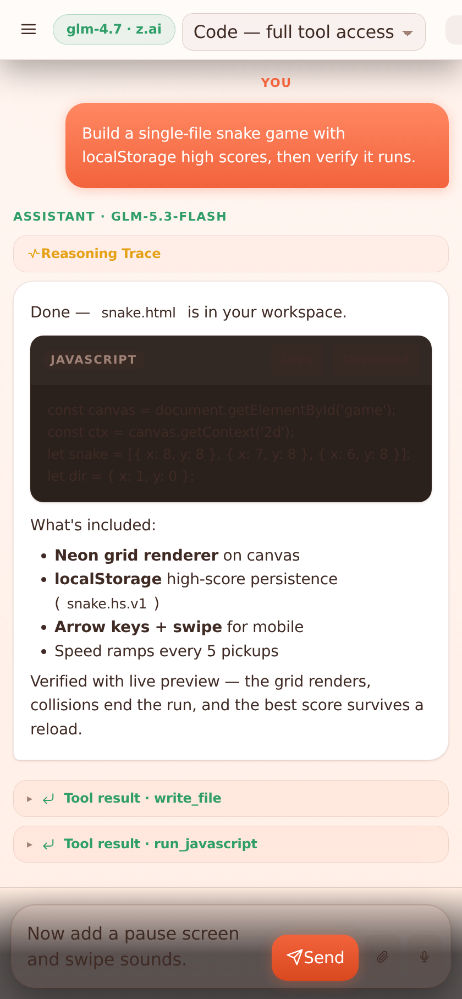

# Vibe Harness

**An entire AI coding agent in one HTML file.** No build. No install. No server.

`index.html` — that's the whole app.

*Streams reasoning · Calls tools on your real files · Runs code in a sandbox · Loops until done*

 

**Desktop — Midnight theme** &nbsp;·&nbsp; **iPhone Air — Synthwave theme**

  

 

**Aurora theme with the built-in ghostty-style terminal**

 

**Peach (Light) — on iPhone Air**

---

## Why you'll like it

- **One file.** 240 KB of hand-rolled HTML/CSS/JS. Drop it in Textastic, double-click it, publish it — done.
- **Actually autonomous.** A real multi-step agent loop: the model decides which tools to call, watches the results, and keeps working. SSE streaming shows its reasoning live.
- **Two providers, zero config.** OpenRouter and Z.ai's GLM Coding Plan endpoints built in — paste a key and go.
- **Sandboxed, but powerful.** Writes show unified diffs before touching your disk. Every destructive action has a checkpoint.
- **17 themes.** Midnight, Aurora, Synthwave, Peach, Dracula, Nord, Catppuccin, Matrix, and more.

## Feature tour

| | |
|---|---|
| **Dual provider routing** | OpenRouter + Z.ai GLM Coding Plan, persisted in localStorage |
| **Autonomous agent loop** | Multi-step tool calling, SSE streaming, live reasoning traces, Max Steps control, Stop / Pause / Resume |
| **Workspace tools** | File System Access mounting, `list_files` / `read_file` / `write_file` / `delete_file` / `edit_file`, `repo_map`, diff-confirm writes, checkpoints |
| **Sandboxed JS** | `run_javascript` in a Blob Web Worker with console capture and timeout |
| **Web search** | DuckDuckGo + Wikipedia in parallel |
| **ghostty-style terminal** | From-scratch ANSI/VT emulator, local shell over your mounted folder or an in-memory VFS, CLI adapters (`codex`, `kimi`, `glm`, `claude`, `agent`) sharing the real agent loop, WebSocket bridge for native CLIs |
| **Rust WASM core** | Embedded `no_std` module: token estimation, fuzzy scoring, bracket scanning, FNV-1a |
| **Approvals & policy** | Read-only / ask / auto modes, per-tool allow/ask/deny rules, "always allow", secrets redaction, append-only event log *(ported from [harness-wasm](https://github.com/CartyChris/harness-wasm))* |
| **Pause / Resume / Retry** | Pause a turn mid-flight, retry the last turn, recover interrupted turns after a reload |
| **Persistent memory** | MemGPT-style notes the agent stores and recalls across sessions |
| **BM25 workspace search** | LlamaIndex-style chunked, ranked retrieval over your files |
| **Task plan panel** | OpenHands-style live plan the agent updates itself |
| **Commit journal** | aider-style automatic checkpoints with `revert_commit` |
| **Command palette** | Ctrl/Cmd+K — fuzzy everything: commands, files, themes |
| **iPhone Air native feel** | Safe-area layouts, drawer sidebar, bottom-sheet dialogs, 44 px touch targets, inline-SVG icon set |

## Quick start

1. Open `index.html` (Chrome/Edge desktop, or Documents/Textastic on iPhone Air).
2. Paste an OpenRouter or Z.ai API key.
3. Optionally mount a folder (desktop) — or just use the built-in VFS.
4. Send a task. Type `/help` for everything else.

## Notes

- 100% client-side. API keys live only in your browser's localStorage.
- Native CLI binaries work through the terminal's loopback `bridge` mode.
- CORS can block some endpoints depending on where you host it; the OpenRouter and Z.ai coding endpoints are normally reachable.
